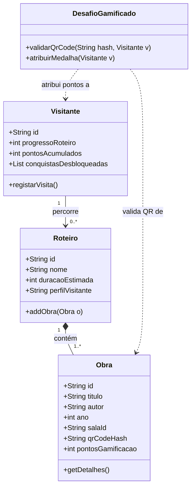
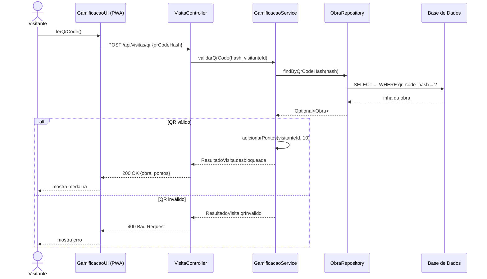

Sessão 4: Arquitetura (Marco M2)
    Exercício 2.1: análise de GestorMuseu

    Baixa coesão. A classe tem 4 responsabilidades distintas:

    1- Acesso a dados (ligação e SQL).
    2- Lógica de negócio (validar a obra).
    3- Gamificação (somar 10 pontos e atualizar o utilizador).
    4- Apresentação (devolver HTML).

    Alto acoplamento:

    . A classe depende de MySQL (jdbc:mysql), de SQL concreto e de HTML concreto.
    . Mudar MySQL para PostgreSQL obriga a alterar a classe de negócio (driver, URL, possivelmente SQL).
    . Mudar para React Native/Flutter obriga a alterar a lógica de negócio, porque devolve HTML em vez de dados.
    . Há ainda SQL injection (qrCodeData e userIp concatenados), recursos nunca fechados e o IP usado como identificador do   utilizador.

Refatorização em 3 camadas

// ===== Camada de Acesso a Dados =====
public interface ObraRepository {                       // contrato: o serviço não sabe se é MySQL ou PostgreSQL
    Optional<Obra> findByQrCodeHash(String qrCodeHash); // Optional evita devolver null
}

// ===== Camada de Negócio =====
public class GamificacaoService {
    private static final int PONTOS_POR_OBRA = 10;      // constante em vez de número mágico

    private final ObraRepository obraRepository;        // depende da abstração, não da implementação
    private final VisitanteRepository visitanteRepository;

    public GamificacaoService(ObraRepository o, VisitanteRepository v) { // injeção por construtor
        this.obraRepository = o;
        this.visitanteRepository = v;
    }

    public ResultadoVisita validarQrCode(String qrCodeHash, String visitanteId) {
        return obraRepository.findByQrCodeHash(qrCodeHash)           // procura a obra
            .map(obra -> {                                           // se existir:
                visitanteRepository.adicionarPontos(visitanteId, PONTOS_POR_OBRA); // atribui pontos
                return ResultadoVisita.desbloqueada(obra.getTitulo(), PONTOS_POR_OBRA);
            })
            .orElse(ResultadoVisita.qrInvalido());                   // senão: resultado de erro tipado
    }
}

// ===== Camada de Apresentação (REST) =====
@RestController
@RequestMapping("/api/visitas")
public class VisitaController {
    private final GamificacaoService service;
    public VisitaController(GamificacaoService service) { this.service = service; }

    @PostMapping("/qr")                                              // POST /api/visitas/qr
    public ResponseEntity<ResultadoVisita> validar(@RequestBody QrRequest req) {
        ResultadoVisita r = service.validarQrCode(req.qrCodeHash(), req.visitanteId());
        return r.isValido() ? ResponseEntity.ok(r)                   // 200 com JSON
                            : ResponseEntity.badRequest().body(r);   // 400 se QR inválido
    }
}

O frontend (PWA, React Native ou Flutter) formata o JSON como quiser. A formatação HTML sai do backend.

Exercício 2.2: A tabela da ficha está correta. Para o passo 4.3 (QR Code), segue o diagrama de sequência.

Passo 4.2: Diagrama de classes (com DesafioGamificado)

Passo 4.3: Diagrama de sequência (validação de QR Code)

Passo 4.4: docs/adr/ADR-001-arquitetura-camadas-rest.md

O modelo da ficha já está completo. Podem usá-lo tal como está, ajustando só “Grupo XX” e a data. Se quiserem reforçar, acrescentem uma secção de alternativas descartadas:
    ## 4. Alternativas consideradas
    * **Monólito com HTML gerado no servidor:** descartado, acopla UI e negócio e dificulta o offline.
    * **App 100% online sem cache:** descartada, as salas de pedra do Palácio dos Carrancas não têm cobertura fiável.