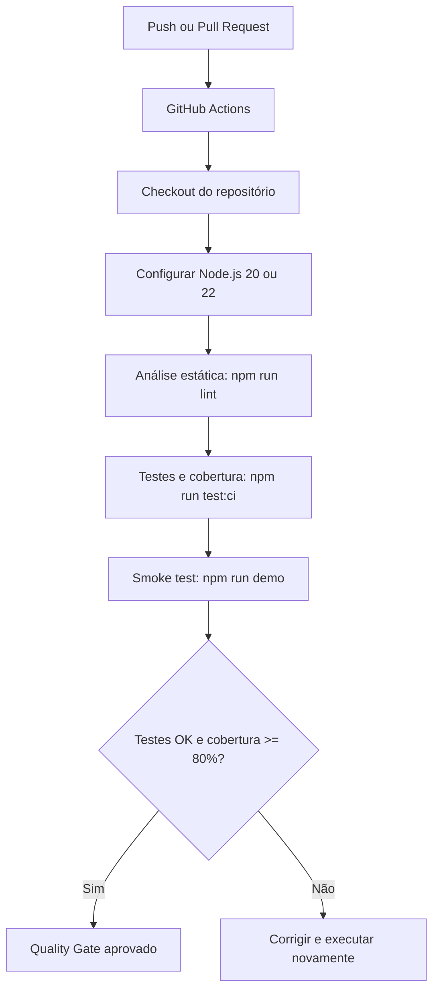

# Sessão 8: CI/CD Introdutório — Pipelines de Integração Contínua com GitHub Actions

## 1. Enquadramento e Objetivos de Aprendizagem

A Sessão 8 inicia o **Bloco II** de Engenharia de Software, dedicado à automatização da garantia de qualidade. Depois de estudar Engenharia de Requisitos, UML, Clean Code e testes automatizados, o objetivo é garantir que cada alteração submetida pela equipa é verificada automaticamente antes de ser integrada na branch principal.

A **Integração Contínua (CI — Continuous Integration)** consiste em integrar código frequentemente, executando verificações automáticas como análise estática, build e testes. A **Entrega Contínua (CD — Continuous Delivery)** complementa a CI, preparando versões validadas para disponibilização; não implica necessariamente uma publicação automática em produção.

### Objetivos Específicos:
- **Compreender CI/CD:** distinguir integração, entrega e implementação contínuas.
- **Identificar as fases de um pipeline:** `Checkout → Setup → Build → Lint → Testes → Cobertura`.
- **Configurar GitHub Actions:** utilizar ficheiros YAML em `.github/workflows/` com eventos, jobs e steps.
- **Aplicar Quality Gates:** impedir a integração de alterações que não cumpram critérios mínimos, nomeadamente testes e cobertura de **80%**.
- **Diagnosticar falhas:** interpretar logs de testes e relatórios de cobertura.
- **Consolidar o Marco M4:** verificar o pipeline da App MNSR Digital e documentar as evidências no GitHub.

---

## 2. Exercícios Prévios de Consolidação (Enunciados & Resoluções)

### Exercício 2.1: Anatomia e Sintaxe YAML do GitHub Actions

#### Enunciado:

Identifique a finalidade das principais diretivas de um workflow e explique por que motivo o evento `pull_request` deve executar testes automaticamente antes do *merge* para a branch de destino.

#### Resolução Técnica:

| Diretiva | Conceito | Finalidade |
| :--- | :--- | :--- |
| `name:` | Nome do workflow | Identifica o pipeline no separador **Actions** do GitHub. |
| `on:` | Eventos (*triggers*) | Define quando executar, por exemplo `push` ou `pull_request`. |
| `jobs:` | Trabalhos | Agrupa os trabalhos que compõem o pipeline. |
| `runs-on:` | Ambiente de execução | Escolhe o runner, por exemplo `ubuntu-latest`. |
| `steps:` | Passos | Define tarefas executadas sequencialmente no mesmo job. |
| `uses:` | Actions reutilizáveis | Executa ações como `actions/checkout@v4` e `actions/setup-node@v4`. |
| `run:` | Comandos | Executa comandos como `npm run lint` e `npm test`. |

**Resposta à questão 2.1.1:** O evento `pull_request` deve vigiar a branch de **destino** (por exemplo `main` ou `develop`) para testar alterações propostas antes da fusão. A execução automática deteta regressões, erros de sintaxe e testes falhados, dando feedback à equipa. Com uma regra de proteção que exija os *status checks*, um PR com CI falhada não pode ser integrado. O evento por si só **não bloqueia** o merge: o bloqueio depende das regras configuradas na branch.

**Exemplo adaptado ao projeto JavaScript:**

```yaml
name: App MNSR Digital - CI Pipeline

on:
  push:
    branches: [main, develop]
  pull_request:
    branches: [main, develop]

jobs:
  qualidade-e-testes:
    runs-on: ubuntu-latest
    steps:
      - name: Checkout do código
        uses: actions/checkout@v4
      - name: Configurar Node.js
        uses: actions/setup-node@v4
        with:
          node-version: '22'
      - name: Análise estática
        run: npm run lint
      - name: Testes e cobertura
        run: npm run test:ci
```

> **Nota:** este é um exemplo didático baseado na ficha. O workflow real da equipa usa a branch `master` e uma matriz com Node.js 20.x e 22.x; não deve ser substituído sem alinhar as branches com a organização do repositório.

---

### Exercício 2.2: Quality Gates e Proteção de Branches

#### Enunciado:

Explique o conceito de *Quality Gate* e indique o objetivo das regras `Require a pull request before merging`, `Require status checks to pass before merging`, `Require code reviews before merging` e `Require conversation resolution before merging`.

#### Resolução Técnica:

Um **Quality Gate** é um conjunto de condições mensuráveis que têm de ser cumpridas antes de aceitar uma alteração. Um pipeline pode verificar se os testes passam e se a cobertura é suficiente; as **Branch Protection Rules** tornam os respetivos resultados obrigatórios para o merge.

| Regra | Objetivo | Efeito no trabalho da equipa |
| :--- | :--- | :--- |
| **Require a pull request before merging** | Promover integração através de PRs. | Evita integrar alterações diretamente pela via normal, sujeitando-as a revisão. |
| **Require status checks to pass before merging** | Exigir verificações automáticas aprovadas. | Bloqueia a fusão enquanto os checks exigidos falharem ou estiverem pendentes. |
| **Require code reviews before merging** | Exigir revisão entre pares. | Um colega precisa de aprovar o PR, conforme a configuração. |
| **Require conversation resolution before merging** | Resolver discussões pendentes. | Impede fechar o PR por merge com conversas de revisão por resolver. |

**Exemplo MNSR Digital:** um PR que modifica `RoteiroService.js` deve executar `npm run lint` e `npm run test:ci`. Caso um teste de duração de roteiros falhe, o PR só deve ser integrado depois da correção. Para impor esta regra, o check correspondente deve estar definido como obrigatório nas definições da branch.

---

### Exercício 2.3: Análise de Logs e *Pair Debugging* de Pipelines

#### Enunciado:

Considere o log da ficha, em que a função `calcular_percentagem(550, 500)` devolve `110.0` quando o teste esperava `100.0`. O relatório indica uma cobertura total de **75%**, inferior ao mínimo de **80%**. Identifique o estágio afetado, as duas causas e as medidas corretivas.

#### Resolução Técnica:

| Elemento | Diagnóstico |
| :--- | :--- |
| **Sintoma / estágio** | Falha na execução de testes automatizados e no controlo de cobertura do pipeline. |
| **Causa 1 — falha funcional** | A função não limita o valor calculado a `100.0%`: devolve `110.0%` para 550 visitantes e capacidade 500. |
| **Causa 2 — Quality Gate** | A cobertura de `75%` viola o limiar definido de `80%`. |
| **Correção funcional** | Aplicar um limite máximo de `100.0%` ao resultado, respeitando a especificação do exercício. |
| **Correção da cobertura** | Criar testes relevantes para os ramos não cobertos até atingir pelo menos `80%`. |

**Exemplo de correção (Python, linguagem do log original):**

```python
def calcular_percentagem(visitantes, capacidade):
    if capacidade <= 0:
        raise ValueError("A capacidade deve ser positiva")
    return min((visitantes / capacidade) * 100.0, 100.0)

assert calcular_percentagem(550, 500) == 100.0
```

A execução termina com código de saída `1` porque existem **duas condições independentes** de falha. Corrigir apenas a função não garante que a cobertura passe a ser suficiente.

---

## 3. Imersão no Caso de Estudo: Pipeline da App MNSR Digital

O projeto de grupo [MNSR Digital](https://github.com/PedroRodriguesUFP/Projeto-de-ESOF) utiliza **JavaScript ES Modules e Node.js**, pelo que os exemplos Python/PyTest e Java/Maven apresentados no enunciado devem ser adaptados às ferramentas efetivamente usadas.

### Pipeline do Marco M4: requisitos da ficha e estado do repositório

| Requisito da Sessão 8 | Implementação observada em `master` | Estado |
| :--- | :--- | :--- |
| Workflow em `.github/workflows/ci.yml` | Ficheiro existente, com workflow de CI. | **Implementado** |
| Triggers para `main` e `develop` em `push`/`pull_request` | `push` para `main`, `master`, `feature/**`, `fix/**`; PR para `main` e `master`. | **Adaptar / justificar** a ausência de `develop` |
| Runner Ubuntu com ambiente configurado | `ubuntu-latest`; matriz Node.js **20.x** e **22.x**. | **Implementado** |
| Análise estática (*lint*) | `npm run lint`, com verificação personalizada de sintaxe, arquitetura e alguns padrões de segurança. | **Implementado** |
| Build e testes automatizados | `npm run test:ci`; projeto sem etapa de compilação separada. | **Implementado para o núcleo**, sujeito a execução |
| Cobertura mínima de 80% obrigatória | É gerado relatório de cobertura, mas **não existe bloqueio automático a 80%**. | **Pendente** |
| Badge oficial no topo do README | O README consultado não inclui o badge da CI. | **Pendente** |
| Registo de uso de IA | Existe `docs/AI_LOG.md`, com histórico do projeto. | **Existe; atualizar se aplicável** |
| Proteção de branch / PR com falha bloqueado | Não comprovada pela leitura dos ficheiros versionados. | **Verificar no GitHub** |

### Fluxo de execução previsto



> **Distinção importante:** o diagrama representa o fluxo **pretendido após acrescentar o limiar de cobertura**. No workflow atual, o relatório é produzido, mas não existe uma condição que rejeite automaticamente cobertura abaixo de 80%.

---

## 4. Guia de Laboratório e Implementação Passo-a-Passo (Marco M4)

### Passo 4.1: Verificar o workflow YAML existente

O ficheiro `.github/workflows/ci.yml` já contém os seguintes passos principais:

```yaml
name: CI — Qualidade, Análise Estática e Testes

on:
  push:
    branches: [main, master, "feature/**", "fix/**"]
  pull_request:
    branches: [main, master]

jobs:
  qualidade-e-testes:
    runs-on: ubuntu-latest
    strategy:
      matrix:
        node-version: [20.x, 22.x]
    steps:
      - name: Checkout do repositório
        uses: actions/checkout@v4
      - name: Configurar Node.js
        uses: actions/setup-node@v4
        with:
          node-version: ${{ matrix.node-version }}
      - name: Análise estática
        run: npm run lint
      - name: Testes automatizados com cobertura
        run: npm run test:ci
      - name: Demonstração executável
        run: npm run demo
```

Esta versão resume as operações relevantes; os nomes completos dos passos podem ser consultados no ficheiro real. Deve confirmar-se se a equipa utiliza `master` como branch principal ou se também pretende criar e proteger `develop`.

### Passo 4.2: Executar as verificações localmente

```bash
git clone https://github.com/PedroRodriguesUFP/Projeto-de-ESOF.git
cd Projeto-de-ESOF

npm run lint
npm test
npm run test:ci
npm run demo
```

- `npm run lint`: verifica sintaxe e determinadas regras arquiteturais/de segurança.
- `npm test`: executa a suite com o test runner nativo do Node.js.
- `npm run test:ci`: executa os testes e mostra o relatório de cobertura.
- `npm run demo`: verifica o funcionamento básico dos serviços do projeto.

**Atenção:** obter um relatório de cobertura não é o mesmo que impor um *Quality Gate*. A cobertura tem de ser analisada e deve existir uma condição automática que provoque falha quando for inferior a 80%.

### Passo 4.3: Configurar um Quality Gate de cobertura de 80%

O comando atual `node --test --experimental-test-coverage` não define, por si só, o mínimo de 80%. Uma possibilidade é configurar uma ferramenta de cobertura com verificação de limiares, ou utilizar uma opção de cobertura mínima suportada pela versão de Node.js adotada, após confirmar a respetiva compatibilidade.

**Critérios a validar:**
1. A medição considera os ficheiros de produção relevantes, e não apenas os módulos importados pelos testes.
2. A cobertura total é pelo menos **80%**, de acordo com a métrica definida pela equipa/docente.
3. Cobertura inferior ao limiar gera um *exit code* diferente de zero.
4. A GitHub Action fica vermelha se o Quality Gate falhar.

Não se deve assinalar este passo como concluído enquanto o bloqueio não for demonstrado numa execução real.

### Passo 4.4: Criar uma Feature Branch e submeter o PR

```bash
git checkout master
git pull origin master
git checkout -b ci/configurar-pipeline-m4

# Depois de atualizar os ficheiros necessários:
git add .github/workflows/ci.yml package.json README.md
git commit -m "ci(workflow): reforcar quality gate do marco M4"
git push -u origin ci/configurar-pipeline-m4
```

Abrir um Pull Request com destino à `master` e consultar o separador **Actions**. Como o workflow já existe, a tarefa é **melhorar e validar** a configuração, não duplicá-la.

### Passo 4.5: Simular uma falha e confirmar o bloqueio

1. Numa branch de testes, alterar **temporariamente** uma asserção em `tests/RoteiroService.test.js` para esperar um resultado incorreto.
2. Fazer commit e push da alteração e abrir/atualizar um PR para `master`.
3. Observar o check falhado no GitHub Actions e guardar uma captura de ecrã ou o log.
4. **Confirmar também a proteção da branch**: apenas com *Required status checks* configurados é possível demonstrar que o merge fica bloqueado.
5. Corrigir a asserção e voltar a submeter. Confirmar a execução verde.

> A alteração errada não deve ser integrada na `master`; deve ser revertida antes do merge.

### Passo 4.6: Adicionar o Badge ao README

Depois de confirmar a execução do workflow, colocar no topo do `README.md`:

```markdown
[](https://github.com/PedroRodriguesUFP/Projeto-de-ESOF/actions/workflows/ci.yml)
```

O badge apresenta o estado da execução correspondente, mas **não prova sozinho** que os critérios de cobertura e proteção de branches estão configurados.

### Passo 4.7: Governação de IA e Atualização do AI Log

Se forem utilizados assistentes de IA na resolução da sessão, adicionar a `docs/AI_LOG.md` uma entrada que identifique:

- **Ferramenta e finalidade:** por exemplo, auxílio na interpretação da S8 e revisão do YAML de CI.
- **Prompt e resultado:** explicação ou código sugerido.
- **Revisão humana:** ficheiros comparados, erros encontrados e ajustes aceites.
- **Validação:** comandos locais e execução do workflow no GitHub, com links ou evidências quando existirem.

A escrita de `Fichas/S8.md` com auxílio de ChatGPT pode ser registada, mas não se deve afirmar que os testes foram executados ou que houve revisão humana antes de isso acontecer.

---

## 5. Checklist de Aceitação do Marco M4

| Item | Critério de Aceitação do Marco M4 | Estado da Equipa (observado) |
| :--- | :--- | :--- |
| **M4.1 — Workflow YAML** | Ficheiro `.github/workflows/ci.yml` versionado com triggers de `push` e `pull_request` nas branches definidas. | [x] **Existe**; confirmar alinhamento com `main`/`develop` |
| **M4.2 — Build & Test** | Checkout, ambiente, linter e testes executados automaticamente com sucesso. | [x] **Configurado**; confirmar a última execução |
| **M4.3 — Quality Gate** | Cobertura mínima de **80%** imposta automaticamente e falha comprovada num PR. | [ ] **Pendente** |
| **M4.4 — Badge & Status** | Badge oficial da CI visível no topo de `README.md`. | [ ] **Pendente** |
| **M4.5 — AI Log & Git** | Utilização de IA registada, se aplicável, com validação humana e commits convencionais. | [ ] **Confirmar e atualizar** |

### Conclusão

O projeto MNSR Digital **já dispõe de um pipeline de CI com análise estática, testes automatizados, relatório de cobertura e demonstração executável**. Para satisfazer integralmente a Sessão 8, é necessário **implementar um bloqueio automático quando a cobertura for inferior a 80%, verificar as regras de proteção de branches, demonstrar um PR rejeitado e colocar o badge no README**. A resolução desta ficha distingue a infraestrutura já implementada da evidência ainda necessária para considerar o Marco M4 concluído.
