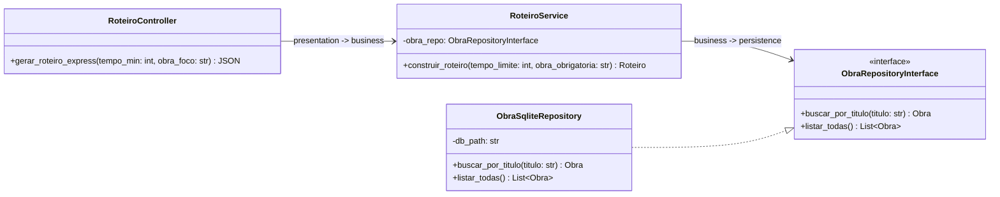
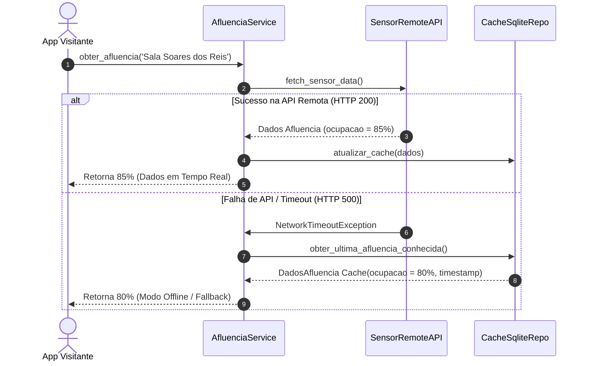

## 1. Enunciado do Cenário Prático

Atingida a meio do semestre na UC de Engenharia de Software (Sessão 7), as equipas de desenvolvimento enfrentam a primeira grande avaliação prática e teórica da unidade curricular: a Demonstração Intermédia (*Live Demo*) dos Marcos M1, M2 e M3 do projeto prático da App Móvel do Museu Nacional Soares dos Reis (MNSR), e a preparação para o Teste Presencial Individual T1 (20% da nota final).

Ao longo do bloco I (sessões 1 a 6), a equipa 'MNSR-TechGroup' evoluiu a solução através dos seguintes marcos de engenharia:
- **Marco M0 & M1 (sessões 1-3):** definição da visão do produto, levantamento de User Stories em BDD Gherkin para o roteiro expresso de 30 min (destacando a obra 'O Desterro'), gestão no GitHub Projects e colaboração via GitHub Flow com Conventional Commits.
- **Marco M2 (sessão 4):** decoupling arquitetural da aplicação monolítica numa Arquitetura em 3 Camadas (Apresentação CLI/REST, Lógica de Negócio e Acesso a Dados/Persistência), modelada em Diagramas UML (Classes e Sequência com alt/else para fallback offline) e formalizada na ADR-001 (SQLite local).
- **Marco M3 (sessões 5-6):** refatorização Clean Code (Boy Scout Rule) para eliminar Code Smells e criação de uma suite robusta de Testes Automatizados unitários em PyTest com TDD e Mocks (`unittest.mock`) para isolar APIs externas e garantir Branch Coverage $\ge 80\%$.

---

## 2. Grupo I: Questões de Conceitos Diretos

### Questão 1.1: Integração Sistémica dos Artefactos do Bloco I

#### Enunciado:
Explique como se relacionam sequencial e logicamente os seguintes artefactos do Bloco I na Engenharia de Software: (a) Visão do Produto; (b) User Story BDD (Gherkin); (c) Diagrama de Classes UML; (d) Testes Automatizados (PyTest); (e) Incremental Release.

#### Resolução Técnica & Critérios:
1. **Visão do Produto:** Estabelece o propósito estratégico de alto nível no **Espaço do Problema**, delimitando as metas de negócio, o público-alvo e o valor a entregar aos visitantes do museu.
2. **User Story BDD (Gherkin):** Desagrega operacionalmente a visão em requisitos funcionais e critérios de aceitação rigorosos e testáveis (`Dado / Quando / Então`), acordados entre clientes e equipa de engenharia.
3. **Diagrama de Classes UML:** Modela a estrutura estática das classes no **Espaço da Solução**, distribuindo responsabilidades pelas camadas de Apresentação, Negócio e Persistência para suportar as necessidades expressas nas User Stories.
4. **Testes Automatizados (PyTest):** Traduzem os cenários BDD em oráculos de código executável antes ou durante a codificação (TDD), assegurando verificação contínua e prevenindo regressões.
5. **Incremental Release:** Incremento de software funcional integrado na branch `main` e etiquetado com tag Git após validação por testes verdes, satisfazendo a *Definition of Done* e pronto a entregar valor ao utilizador.

---

### Questão 1.2: Critérios da Live Demo Intermédia e Governação

#### Enunciado:
Quais são os três elementos obrigatórios que uma equipa de Engenharia de Software deve demonstrar numa Live Demo Intermédia do projeto prático (Marcos M1-M3) e qual o papel do GitHub Projects e da Definition of Done (DoD) nesse processo?

#### Resolução Técnica & Critérios:
1. **Três Elementos Obrigatórios da Live Demo:**
   - **a) Demonstração Funcional Executável:** Apresentação da aplicação a correr em direto sem falhas ou exceções, executada a partir do código estável integrado na branch `main`.
   - **b) Execução Transparente de Testes Automatizados:** Execução da suite de testes PyTest no terminal comprovando 100% de testes verdes e relatório de cobertura de ramos (*Branch Coverage*) $\ge 80\%$.
   - **c) Evidência de Engenharia e Governação:** Exibição dos diagramas UML no repositório, decisão arquitetural `docs/adr/ADR-001-caching-offline.md`, registo de transparência de IA em `docs/AI_LOG.md` e histórico de Pull Requests.
2. **Papel do GitHub Projects e da DoD:**
   - O **GitHub Projects** fornece prova de governação ágil transparente das tarefas através das colunas *To Do*, *In Progress* e *Done*.
   - A **Definition of Done (DoD)** atua como barreira de qualidade: impede que qualquer User Story seja considerada concluída sem possuir cobertura de testes adequada, revisão por pares aprovada e documentação técnica atualizada.

---

### Questão 1.3: Estrutura e Matriz do Teste Presencial T1

#### Enunciado:
Como se diferencia a avaliação conceptual do Teste Presencial Individual T1 (20%) da simples memorização de sintaxe de linguagens de programação? Dê dois exemplos de questões tipicamente avaliadas em T1.

#### Resolução Técnica & Critérios:
1. **Diferenciação Fundamental:** O Teste T1 avalia competências de raciocínio crítico de engenharia, diagnóstico de falhas arquiteturais, aplicação de princípios fundamentais (INVEST, Clean Code, ISO/IEC 25010) e abstração em modelos, em vez da memorização de comandos ou particularidades sintáticas de linguagens.
2. **Exemplos Típicos de Questões T1:**
   - *Exemplo A:* Analisar um trecho de código fornecido, identificar 3 *Code Smells* específicos e apresentar a sua refatorização baseada na *Boy Scout Rule*.
   - *Exemplo B:* Dado um cenário BDD em Gherkin, modelar o Diagrama de Sequência UML equivalente com blocos de contingência (`alt/else`) ou implementar um teste unitário em PyTest com Mock para isolar uma API remota.

---

## 3. Grupo II: Questões de Complexidade Média

### Questão 2.1: Rastreabilidade Transversal BDD $\rightarrow$ UML $\rightarrow$ PyTest

#### Enunciado:
Considere a User Story: *"Como visitante do museu, quero gerar um roteiro expresso de 30 minutos focando na escultura O Desterro, para que possa aproveitar a visita num intervalo limitado de tempo"*.  
Construa: (a) O cenário BDD em Gherkin; (b) O diagrama de classes em sintaxe Mermaid.js cobrindo as 3 camadas; (c) O esboço da classe de teste unitário em PyTest.

#### Resolução Técnica:

##### a) Cenário BDD em Gherkin:
```gherkin
Funcionalidade: Roteiro Expresso MNSR
  Cenário: Geração bem-sucedida de roteiro de 30 minutos
    Dado que o acervo do museu contém a obra "O Desterro" com duração estimada de 10 min
    E que existem obras complementares "Retrato de Silva Porto" (10 min) e "Jarra de Cerâmica" (10 min)
    Quando o visitante solicita um roteiro com tempo limite de 30 min incluindo "O Desterro"
    Então o sistema gera um roteiro com exatamente 3 obras e duração total de 30 min
```

##### b) Diagrama de Classes UML (Mermaid.js - 3 Camadas):


##### c) Esboço do Teste PyTest com Mock:
```python
# tests/test_roteiro_service.py
from unittest.mock import Mock
from dataclasses import dataclass
from typing import List

@dataclass
class Obra:
    nome: str
    duracao: int

@dataclass
class Roteiro:
    obras: List[Obra]
    duracao_total: int

class RoteiroService:
    def __init__(self, obra_repo):
        self.obra_repo = obra_repo

    def construir_roteiro(self, tempo_limite: int, obra_obrigatoria: str) -> Roteiro:
        obra_foco = self.obra_repo.buscar_por_titulo(obra_obrigatoria)
        todas = self.obra_repo.listar_todas()
        selecionadas = [obra_foco]
        tempo = obra_foco.duracao
        for obra in todas:
            if obra.nome != obra_obrigatoria and (tempo + obra.duracao <= tempo_limite):
                selecionadas.append(obra)
                tempo += obra.duracao
        return Roteiro(obras=selecionadas, duracao_total=tempo)

def test_gerar_roteiro_expresso_30min_sucesso(mocker):
    mock_repo = mocker.Mock()
    mock_repo.buscar_por_titulo.return_value = Obra("O Desterro", 10)
    mock_repo.listar_todas.return_value = [
        Obra("O Desterro", 10),
        Obra("A", 10),
        Obra("B", 10)
    ]

    service = RoteiroService(mock_repo)
    roteiro = service.construir_roteiro(30, "O Desterro")

    assert len(roteiro.obras) == 3
    assert roteiro.duracao_total == 30
    mock_repo.buscar_por_titulo.assert_called_once_with("O Desterro")
```

---

### Questão 2.2: Auditoria de Refatorização e Boy Scout Rule

#### Enunciado:
Durante a auditoria ao código do módulo de sugestão de rotas, foi encontrado o método abaixo. Identifique 3 Code Smells e apresente o código refatorizado aplicando os princípios de Clean Code.

```python
# Código com ruídos e Smells encontrado na auditoria
def processa_obras(lst, t, flag=False):
    # metodo que faz tudo
    res = []
    tot = 0
    for x in lst:
        if x['ativo'] == True:
            if flag == True or x['categoria'] == 'escultura':
                if tot + x['dur'] <= t:
                    res.append(x)
                    tot += x['dur']
                    print("Adicionada obra: " + x['nome'])  # I/O no negócio!
    return res, tot
```

#### Resolução Técnica:
1. **Identificação dos 3 Code Smells:**
   - **Nomes Não Reveladores de Intenção:** Variáveis sem semântica (`lst`, `t`, `res`, `tot`, `x`, `flag`).
   - **Flag Parameter & Aninhamento Profundo:** Parâmetro booleano `flag` que altera o fluxo interno combinado com 3 níveis de `if` aninhados (*Arrow Anti-Pattern*).
   - **Efeito Secundário (I/O na Camada de Negócio):** Chamada de `print()` no meio do algoritmo, acoplando a lógica de negócio à saída padrão de consola.
2. **Código Refatorizado (Clean Code):**
```python
# src/business/roteiro_filter_service.py
from dataclasses import dataclass
from typing import List

@dataclass(frozen=True)
class Obra:
    nome: str
    categoria: str
    duracao_minutos: int
    ativa: bool = True

class RoteiroFilterService:
    def selecionar_obras_por_tempo(
        self,
        obras: List[Obra],
        tempo_limite: int,
        incluir_todas_categorias: bool = False
    ) -> List[Obra]:
        obras_selecionadas: List[Obra] = []
        tempo_acumulado = 0

        for obra in obras:
            if not obra.ativa:
                continue
            if not incluir_todas_categorias and obra.categoria != "escultura":
                continue
            if tempo_acumulado + obra.duracao_minutos <= tempo_limite:
                obras_selecionadas.append(obra)
                tempo_acumulado += obra.duracao_minutos

        return obras_selecionadas
```

---

### Questão 2.3: Isolamento com Mocks e Análise de Cobertura

#### Enunciado:
Explique porque razão um teste unitário que faz chamadas reais a uma base de dados externa SQLite ou API HTTP remota do Museu não é considerado um 'teste unitário puro'. Mostre como transformar esse teste num teste unitário isolado com `unittest.mock`.

#### Resolução Técnica:
1. **Razão do Teste Não Ser Unitário Puro:** Um teste unitário puro deve verificar uma única unidade funcional (classe/método) em memória, de forma determinística e ultrarrápida. Ao aceder ao disco rígido (base SQLite persistida) ou à rede HTTP, o teste converte-se num **Teste de Integração**, ficando vulnerável a ficheiros em disco bloqueados, contenção de I/O, estado residual de testes anteriores e falhas externas de rede.
2. **Transformação de Código:**

```python
# Teste de Integracao Lento (Incorreto para unitário):
def test_busca_obra_real():
    repo = ObraSqliteRepository('banco_real.db')  # Acessa disco!
    obra = repo.buscar('O Desterro')
    assert obra is not None

# Teste Unitário Isolado Puro (Correto):
def test_busca_obra_unitario(mocker):
    # Simula a conexão com a base de dados em memória
    mock_db = mocker.patch('src.persistence.database_connection')
    mock_db.query.return_value = [{'id': 1, 'nome': 'O Desterro', 'duracao': 10}]
    
    class ObraRepository:
        def __init__(self, db):
            self.db = db
        def buscar(self, titulo: str):
            res = self.db.query(titulo)
            return res[0] if res else None

    repo = ObraRepository(mock_db)
    obra = repo.buscar('O Desterro')
    
    assert obra['nome'] == 'O Desterro'
    mock_db.query.assert_called_once_with('O Desterro')
```

---

## 4. Grupo III: Questões de Elevada Complexidade

### Questão 3.1: Simulação Prática de Exame T1

#### Enunciado:
Uma das questões de exame presencial T1 apresenta o seguinte enunciado de síntese arquitetural e refatorização. Resolva-o na íntegra:  
*[ENUNCIADO T1]* A app do MNSR inclui o serviço de notificação de afluência `AfluenciaService`. Atualmente, quando a API remota de sensores de sala falha (HTTP 500/Timeout), a app crasha e deixa de funcionar.  
1. Desenhe o Diagrama de Sequência UML (Mermaid.js) que representa o fluxo com tratamento condicional (`alt/else`) para recorrer a cache local SQLite em caso de falha de rede.  
2. Escreva o teste TDD em PyTest que simula o Timeout da API remota e verifica se a cache local é consultada e os dados de fallback são retornados.

#### Resolução Técnica:

##### 1. Diagrama de Sequência UML em Mermaid.js (com `alt/else`):


##### 2. Teste TDD em PyTest com Tratamento de Exception e Fallback:
```python
# tests/test_afluencia_fallback.py
import pytest
from unittest.mock import Mock

class AfluenciaService:
    def __init__(self, api_client, cache_repo):
        self.api_client = api_client
        self.cache_repo = cache_repo

    def obter_afluencia_sala(self, nome_sala: str) -> dict:
        try:
            dados = self.api_client.fetch_sensor_data()
            self.cache_repo.atualizar_cache(dados)
            return {"sala": nome_sala, "ocupacao": dados["ocupacao"], "fonte": "TEMPO_REAL"}
        except Exception:
            dados_cache = self.cache_repo.obter_ultima_afluencia_conhecida()
            return {
                "sala": nome_sala,
                "ocupacao": dados_cache["ocupacao"],
                "fonte": "CACHE_OFFLINE"
            }

def test_afluencia_fallback_para_cache_em_caso_de_timeout_api():
    mock_api = Mock()
    mock_api.fetch_sensor_data.side_effect = TimeoutError('API Unreachable')

    mock_cache = Mock()
    mock_cache.obter_ultima_afluencia_conhecida.return_value = {
        'sala': 'Soares dos Reis',
        'ocupacao': 80
    }

    service = AfluenciaService(api_client=mock_api, cache_repo=mock_cache)
    resultado = service.obter_afluencia_sala('Soares dos Reis')

    assert resultado['ocupacao'] == 80
    assert resultado['fonte'] == 'CACHE_OFFLINE'
    mock_api.fetch_sensor_data.assert_called_once()
    mock_cache.obter_ultima_afluencia_conhecida.assert_called_once_with()
```

---

### Questão 3.2: Guião da Live Demo Intermédia e Defesa Técnica

#### Enunciado:
Estruture o guião cronológico de 5 minutos para a Live Demo Intermédia do grupo frente ao júri técnico (professores e PO), especificando quem fala, o que é demonstrado em cada minuto e como fundamentar as decisões do repositório (UML, ADR, AI_LOG.md e PyTest).

#### Resolução Técnica & Critérios:
- **Minuto 00:00 - 01:00 (Scrum Master):** Apresentação da equipa, contextualização da Visão do Produto MNSR e exibição do quadro Kanban no GitHub Projects (comprovação de todas as User Stories M1 a M3 em estado *Done* em conformidade com a Definition of Done).
- **Minuto 01:00 - 02:30 (Lead Architect):** Demonstração da aplicação funcional em direto: seleção e geração do Roteiro Expresso de 30 minutos em torno de *"O Desterro"*; simulação de perda de sinal de rede e exibição da resiliência offline através do carregamento de dados a partir da cache SQLite local. Exibição rápida dos diagramas UML de classes e de sequência no `README.md` e justificação da decisão formalizada em `docs/adr/ADR-001-caching-offline.md`.
- **Minuto 02:30 - 04:00 (Lead QA / Developer):** Abertura do terminal e execução em tempo real do comando `pytest --cov=src --cov-branch --cov-report=html`. Exibição de 100% de testes verdes e barreira de Branch Coverage $\ge 80\%$. Apresentação de um teste unitário evidenciando o isolamento de dependências com Mockito/`unittest.mock`.
- **Minuto 04:00 - 05:00 (Toda a Equipa):** Exibição do registo de proveniência de Inteligência Artificial em `docs/AI_LOG.md`, comprovando o processo de validação crítica e humana de código (*Human-in-the-Loop*), seguido de resposta às questões individuais de arguição técnica do júri.

---

### Questão 3.3: Checklist de Auditoria de Repositório GitHub (M1-M3)

#### Enunciado:
Como auditor técnico de software, elabore a checklist final em 6 pontos rigorosos para validar se o repositório do grupo cumpre integralmente os requisitos dos Marcos M1, M2 e M3 antes da submissão do Bloco I.

#### Resolução Técnica & Critérios:
- [x] **1. Estrutura de Diretórios Normalizada:** Presença estrita da organização em 3 camadas e pastas de suporte: `src/presentation`, `src/business`, `src/persistence`, `tests/`, `docs/adr/` e `.github/workflows/`.
- [x] **2. Governação & Rastreabilidade de IA:** Ficheiro `docs/AI_LOG.md` devidamente preenchido com os prompts enviados, excertos de código gerado e a justificação detalhada da validação humana realizada (*Human-in-the-Loop*).
- [x] **3. Histórico de Commits & GitHub Flow:** Ausência de commits diretos na branch principal (`main`); mensagens em formato *Conventional Commits* (`feat:`, `fix:`, `docs:`, `test:`) e submissões obrigatoriamente associadas a Pull Requests aprovados via *Peer Review*.
- [x] **4. Modelação & Decisões Registadas:** Diagramas UML de Classes e de Sequência renderizados em Mermaid.js no `README.md` e registo da decisão arquitetural no ficheiro `docs/adr/ADR-001-caching-offline.md` no padrão Nygard/MADR.
- [x] **5. Qualidade de Código & Clean Code:** Ausência de funções de I/O (`print()`) na camada de negócio, eliminação de código morto/comentado e validação pelo linter `flake8` sem erros.
- [x] **6. CI/CD & Testes Automatizados:** Pipeline `.github/workflows/ci.yml` ativo e verde no GitHub Actions, executando suite de testes PyTest com isolamento de dependências via Mocks e Cobertura de Ramos (*Branch Coverage*) $\ge 80\%$.