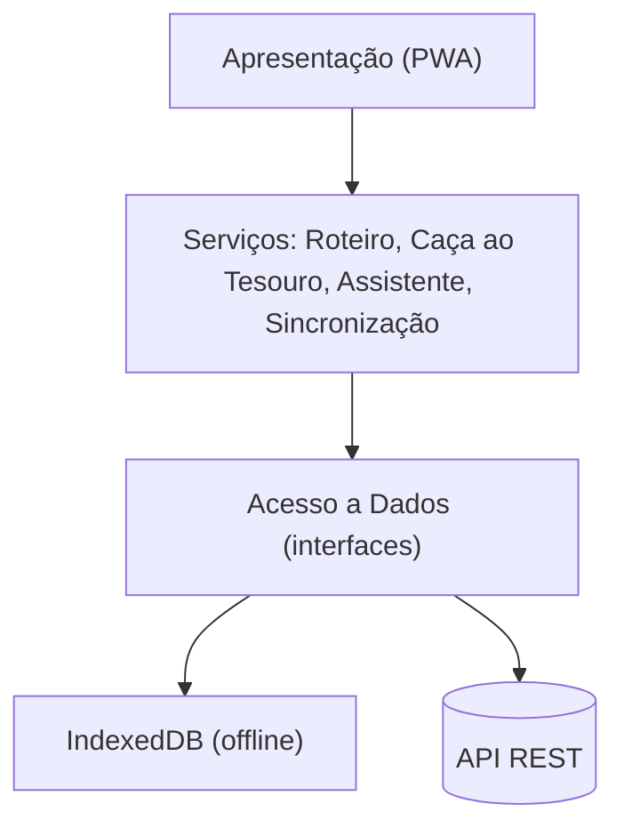

# App MNSR Digital

**Equipa 01:** Pedro Rodrigues, Diogo Borges, Diogo Vicente, Tiago Vaz

## Problema
O Museu Nacional Soares dos Reis recebe cerca de 85.000 visitantes/ano, 62% seniores
e só 15% jovens, com permanência média de 42 minutos. Precisa de atrair e reter
públicos mais novos.

## Solução
Aplicação móvel/PWA com roteiros por tempo, caça ao tesouro com QR Codes,
assistente de IA e funcionamento offline.

## Instalação

Pré-requisitos: **Node.js ≥ 20** (sem dependências externas).

  1. Executar análise estática (sintaxe, arquitetura ADR-0002 e segredos RNF05)
npm run lint

  2. Executar os 20 testes automatizados (unitários e de integração)
npm test

  3. Executar testes com relatório de cobertura (CI)
npm run test:ci

  4. Executar demonstração do núcleo (roteiro 30 min + caça ao tesouro offline + sincronização)
npm run demo

## Visão do Produto

- **PARA** os jovens, famílias e turistas culturais que visitam o Porto,
- **QUE** procuram uma experiência museológica dinâmica, personalizada e interativa,
- **A APP MNSR DIGITAL** é uma aplicação móvel inteligente e gamificada,
- **QUE** oferece roteiros por tempo disponível, caça ao tesouro por QR Code e um guia conversacional de IA sobre as obras,
- **AO CONTRÁRIO DOS** guias áudio estáticos e brochuras em papel,
- **O NOSSO PRODUTO** aumenta o envolvimento do visitante, promove o regresso do público local e ajuda a gerir o fluxo nas salas.

## Documentação

| Documento | Conteúdo | Marco |
| --- | --- | --- |
| [Requisitos](docs/requisitos.md) | User stories e RNF prioritários | M1 |
| [Arquitetura e UML](docs/arquitetura.md) | Casos de uso, classes, camadas, sequência (Mermaid) | M2 |
| [Rastreabilidade](docs/rastreabilidade.md) | Requisito → desenho → teste previsto | M2 |
| [ADR-0001](docs/adr/0001-pwa-offline-first.md) | PWA offline-first | M2 |
| [ADR-0002](docs/adr/0002-arquitetura-em-camadas-e-api-rest.md) | Arquitetura em camadas e API REST | M2 |
| [AI Log](docs/AI_LOG.md) | Registo de uso de IA generativa | M0–M6 |
| [Equipa](docs/EQUIPA.md) | Membros e funções | M0 |

## Arquitetura (resumo)

Três camadas (Apresentação → Serviço → Acesso a Dados) com dependências apenas de cima para baixo.
A PWA guarda o catálogo e o progresso localmente (IndexedDB) para funcionar nas galerias do piso -1 sem rede,
e sincroniza com a API REST quando a rede regressa. Detalhes e diagramas em [`docs/arquitetura.md`](docs/arquitetura.md).

