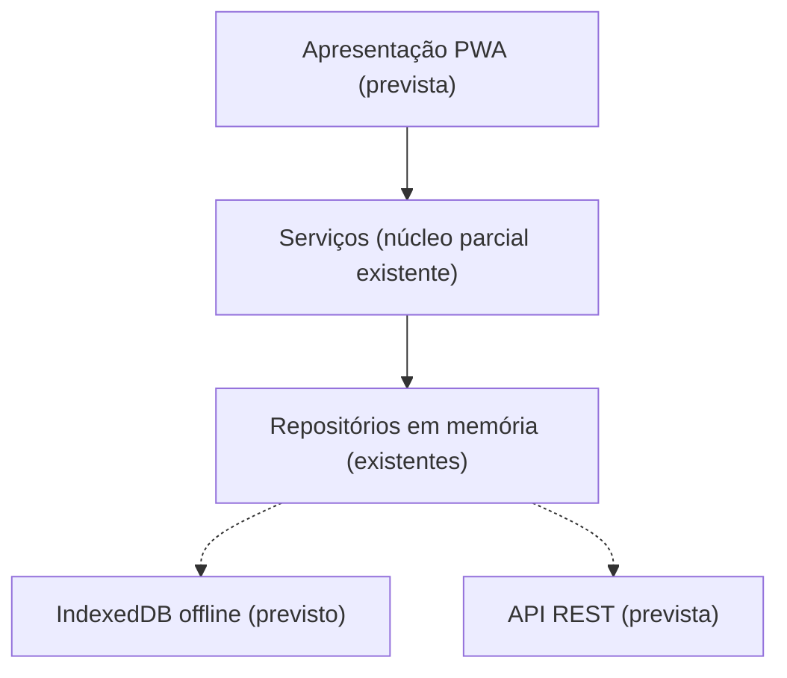

# App MNSR Digital

**Equipa 01:** Pedro Rodrigues, Diogo Borges, Diogo Vicente, Tiago Vaz.

## Problema
O Museu Nacional Soares dos Reis pretende proporcionar experiências de visita mais dinâmicas, sobretudo a jovens, famílias e turistas com pouco tempo. Os valores de público anteriormente referidos neste README devem ser confirmados com uma fonte antes de serem usados como estatísticas oficiais.

## Visão do produto
- **Para** jovens, famílias e turistas culturais que visitam o Porto;
- **que** procuram visitas flexíveis e interativas;
- **MNSR Digital** é uma aplicação móvel/PWA proposta;
- **que** prevê roteiros por duração, consulta offline, fichas de obras, caça ao tesouro por QR e assistente IA fundamentado no acervo;
- **ao contrário de** materiais de visita estáticos, procura adaptar a experiência ao tempo e interesses do visitante.

## Estado atual do repositório (21-10-2026)

Existe um **núcleo JavaScript executável sem interface gráfica**: modelos de domínio, `RoteiroService`, `CacaTesouroService`, `SincronizacaoService`, repositórios em memória, testes automatizados, análise estática, `Logger` e pipeline CI. A interface PWA, IndexedDB, Service Worker, API REST e assistente IA são componentes planeados; não estão demonstrados como funcionalidades completas do repositório.

## Instalação e validação

Requisito: **Node.js ≥ 20**. O núcleo utiliza o test runner nativo do Node.js.

```bash
npm run lint     # análise estática
npm test         # testes automatizados
npm run test:ci  # testes em modo CI / cobertura
npm run demo     # roteiro de exemplo, caça e sincronização (sem UI)
```

O README do repositório assinala **20 testes** após o M4. Deve confirmar-se a execução local e o resultado da CI antes de cada entrega.

## Requisitos do backlog (IDs oficiais)

| User story | Funcionalidade | Estado do núcleo |
| --- | --- | --- |
| [US-01](https://github.com/PedroRodriguesUFP/Projeto-de-ESOF/issues/5) | Gerar roteiro por duração | Lógica implementada; sem UI |
| [US-02](https://github.com/PedroRodriguesUFP/Projeto-de-ESOF/issues/6) | Consultar roteiro offline | Parcial; sem cache persistente/PWA |
| [US-03](https://github.com/PedroRodriguesUFP/Projeto-de-ESOF/issues/7) | Consultar ficha de O Desterro | Por implementar como ecrã |
| [US-04](https://github.com/PedroRodriguesUFP/Projeto-de-ESOF/issues/8) | Ler QR e desbloquear pista | Lógica implementada; sem leitor UI |
| [US-05](https://github.com/PedroRodriguesUFP/Projeto-de-ESOF/issues/9) | Receber prémio ao concluir caça | Lógica implementada; sem ecrã |
| [US-06](https://github.com/PedroRodriguesUFP/Projeto-de-ESOF/issues/10) | Perguntar ao assistente IA | Por implementar |

A matriz completa de testes e limitações encontra-se em [`docs/rastreabilidade.md`](docs/rastreabilidade.md).

## Documentação

| Documento | Conteúdo |
| --- | --- |
| [Requisitos](docs/requisitos.md) | Stakeholders, 6 user stories e requisitos não funcionais |
| [Arquitetura e UML](docs/arquitetura.md) | Diagramas, arquitetura proposta e distinção entre existente/planeado |
| [Rastreabilidade](docs/rastreabilidade.md) | Issues → componentes → testes → lacunas |
| [ADR-0001](docs/adr/0001-pwa-offline-first.md) | Justificação da escolha PWA offline-first |
| [ADR-0002](docs/adr/0002-arquitetura-em-camadas-e-api-rest.md) | Arquitetura em camadas e API REST prevista |
| [M3](docs/m3-incremento.md) | Histórico do incremento executável; numeração antiga documentada na rastreabilidade |
| [M4](docs/m4-ci-qualidade.md) | CI, análise estática e logging |
| [AI Log](docs/AI_LOG.md) | Registo de uso de IA (M0–M6) |
| [Equipa](docs/EQUIPA.md) | Elementos e funções |

## Arquitetura resumida



**Nota de âmbito:** a gestão de salas e a afluência agregada apareciam em documentação antiga como `US06`. Não são a `US-06` original do backlog, que corresponde ao assistente IA. O filtro de obras indisponíveis continua a ser um critério da `US-01`.
