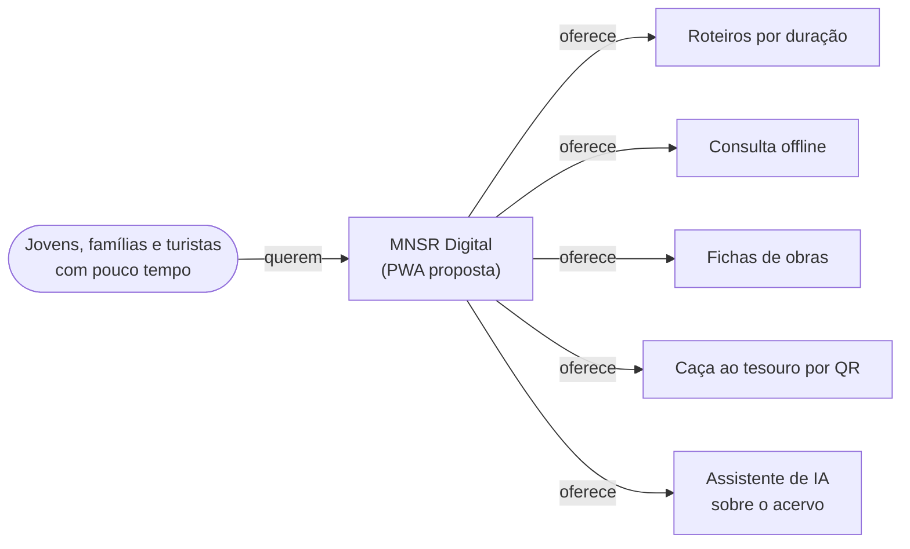
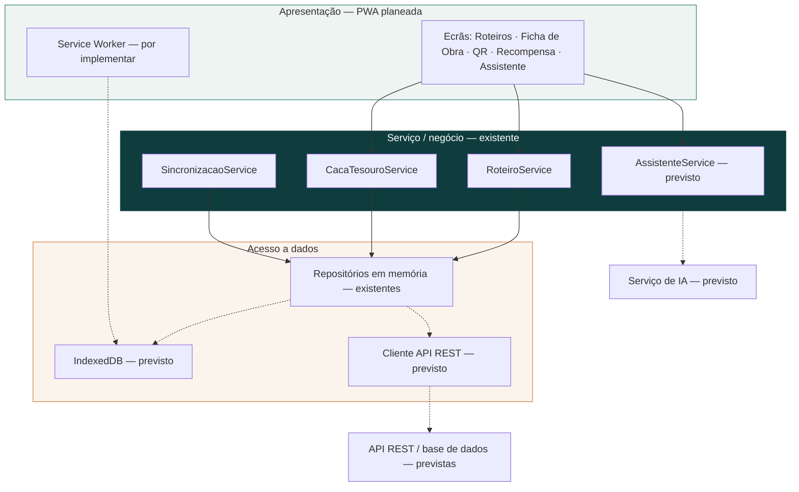

MNSR Digital
> PWA de visita interativa ao Museu Nacional Soares dos Reis — roteiros por duração, consulta offline, fichas de obras, caça ao tesouro por QR Code e assistente de IA fundamentado no acervo.


Equipa 01 — Pedro Rodrigues (desenvolvimento) · Diogo Borges (documentação) · Diogo Vicente (documentação e desenvolvimento)
Unidade curricular: Engenharia de Software, Licenciatura em Engenharia Informática, UFP — 2026/2027
---
Índice
O problema
Visão do produto
Estado atual (semana 10 — M5)
Funcionalidades (backlog)
Arquitetura
Como instalar e validar
Estrutura do repositório
Documentação completa
Uso de IA generativa
Equipa
---
O problema
O Museu Nacional Soares dos Reis (MNSR) quer oferecer visitas mais dinâmicas, sobretudo a jovens, famílias e turistas com pouco tempo. Os materiais de visita atuais são estáticos e não se adaptam ao tempo disponível nem aos interesses de cada visitante.
> Os valores de público referidos em versões anteriores deste README devem ser confirmados com uma fonte oficial antes de serem usados como estatística.
Visão do produto

Ao contrário de materiais de visita estáticos, o MNSR Digital procura adaptar a experiência ao tempo e aos interesses de cada visitante.
Estado atual (semana 10 — M5)
Existe um núcleo JavaScript executável sem interface gráfica: modelos de domínio, serviços de roteiro/caça ao tesouro/sincronização, repositórios em memória, 20 testes automatizados, análise estática, logging estruturado e pipeline de CI. A interface PWA, o IndexedDB, o Service Worker, a API REST e o assistente de IA são componentes planeados — não estão ainda implementados como funcionalidades completas.
Marco	Entregue	Semana
M0	Equipa, papéis, carta de IA	1
M1	Visão, stakeholders, backlog, requisitos	2
M2	Modelos UML, arquitetura, ADRs	4
M3	Incremento executável, 17 testes, histórico Git	6
M4	CI, análise estática, logging (+3 testes → 20)	8
M5	Revisão de qualidade, refactoring, segurança de dependências ✅ atual	10
M6	Release candidate, testes finais, demonstração	12/13
```bash
npm run lint     # análise estática
npm test         # 20 testes automatizados
npm run test:ci  # testes com relatório de cobertura
npm run demo     # roteiro de exemplo, caça e sincronização (sem UI)
```
Funcionalidades (backlog)
IDs oficiais das issues do GitHub:
User story	Funcionalidade	Prioridade	Estado do núcleo
US-01	Gerar roteiro por duração (30/60/90 min)	Alta	✅ Lógica implementada · sem UI
US-02	Consultar roteiro offline	Alta	🟡 Parcial · sem cache persistente/PWA
US-03	Consultar ficha de O Desterro	Alta	⬜ Por implementar como ecrã
US-04	Ler QR e desbloquear pista	Alta	✅ Lógica implementada · sem leitor UI
US-05	Receber prémio ao concluir a caça	Média	✅ Lógica implementada · sem ecrã
US-06	Perguntar ao assistente de IA	Média	⬜ Por implementar
A matriz completa de testes e limitações está em `docs/rastreabilidade.md`.
Arquitetura
Arquitetura em 3 camadas, dependências unidirecionais (de cima para baixo) — ver ADR-0002:

Decisões arquiteturais (ADRs):
ADR-0001 — PWA offline-first com Service Worker + IndexedDB, para consulta sem rede nas galerias do piso -1 (US-02, RNF01).
ADR-0002 — 3 camadas com serviços sobre interfaces injetadas + API REST versionada (`/api/v1`).
Diagramas completos de casos de uso, classes e sequência: `docs/arquitetura.md`.
Como instalar e validar
Requisito: Node.js ≥ 20 (usa o test runner nativo do Node, sem dependências de teste externas).
```bash
git clone https://github.com/PedroRodriguesUFP/Projeto-de-ESOF.git
cd Projeto-de-ESOF
npm install
npm run check   # lint + testes
npm run demo    # demonstração do núcleo (sem interface gráfica)
```
Estrutura do repositório
```text
Projeto-de-ESOF/
├── src/
│   ├── dominio/     # Entidades: Obra, Roteiro, Sala, Visitante, ProgressoCaca
│   ├── servico/      # RoteiroService, CacaTesouroService, SincronizacaoService
│   ├── dados/        # Repositórios em memória
│   └── infra/        # Logger estruturado
├── tests/             # Testes unitários, integração e e2e
├── scripts/           # Análise estática (lint)
├── docs/              # Requisitos, arquitetura, ADRs, rastreabilidade, AI log
├── public/            # Protótipo de interface (app.js, style.css, index.html)
├── data/              # Catálogo de exemplo
└── .github/workflows/ # Pipeline de CI
```
Documentação completa
Documento	Conteúdo
Requisitos	Stakeholders, 6 user stories e requisitos não funcionais
Arquitetura e UML	Casos de uso, classes, sequência e arquitetura em camadas
Rastreabilidade	Issues → componentes → testes → lacunas
ADR-0001	Justificação da PWA offline-first
ADR-0002	Arquitetura em camadas e API REST
M3 — Incremento	Histórico do incremento executável (17 testes)
M4 — CI e qualidade	Pipeline de CI, análise estática e logging
M5 — Qualidade e segurança	Code review, refactoring, segurança de dependências (este marco)
AI Log	Registo de uso de IA generativa (M0–M6)
Equipa	Elementos e funções
Uso de IA generativa
O uso de ferramentas de IA generativa é admitido no desenvolvimento, com declaração obrigatória no `docs/AI_LOG.md`: ferramenta, tarefa, finalidade, validação humana e limitações. Zona verde (uso livre), zona amarela (declarar e rever criticamente) e zona vermelha (proibido em testes e exame presencial) — regras completas na carta de IA da equipa.
Equipa
Nome	Nº estudante	Função
Pedro Rodrigues	2024114929	Desenvolvimento
Diogo Borges	2022120279	Documentação
Diogo Vicente	2024115283	Documentação e desenvolvimento
---
<sub>Nota de âmbito: a gestão de salas e a afluência agregada apareciam em documentação antiga como `US06` — não correspondem à `US-06` original do backlog (assistente de IA). O filtro de obras indisponíveis é um critério da `US-01`.</sub>
