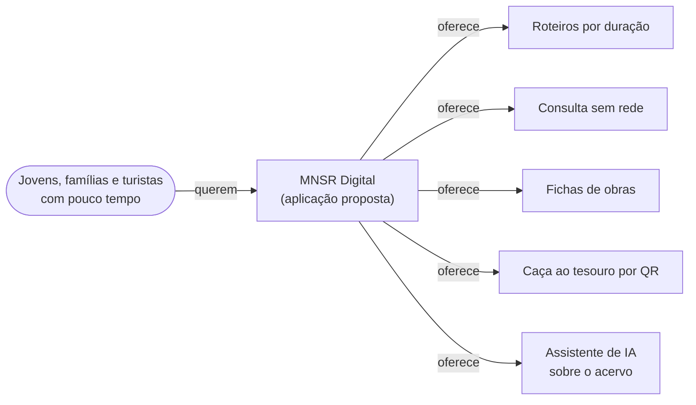
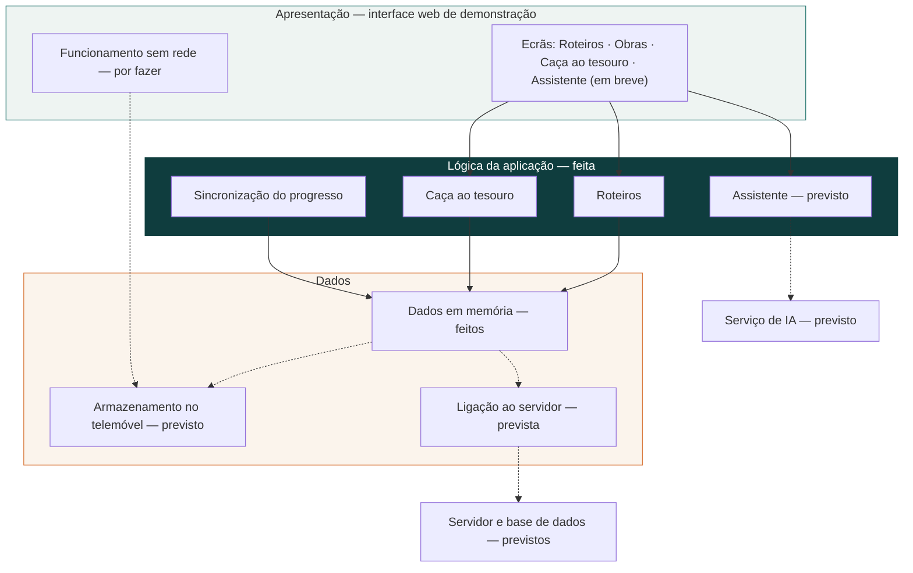

# MNSR Digital

> Uma aplicação para visitar o Museu Nacional Soares dos Reis à tua medida: escolhes quanto tempo tens, recebes um percurso pelas obras, consultas tudo mesmo sem rede, jogas uma caça ao tesouro com códigos QR e, no futuro, tiras dúvidas com um assistente que só responde com base no acervo do museu.


**Equipa 01** — Pedro Rodrigues (desenvolvimento) · Diogo Borges (documentação) · Diogo Vicente (documentação e desenvolvimento)

**Unidade curricular:** Engenharia de Software, Licenciatura em Engenharia Informática, UFP — 2026/2027

---

## Índice

- [O problema](#o-problema)
- [Visão do produto](#visão-do-produto)
- [Estado atual (semana 10 — M5)](#estado-atual-semana-10--m5)
- [Funcionalidades (backlog)](#funcionalidades-backlog)
- [Arquitetura](#arquitetura)
- [Como instalar e validar](#como-instalar-e-validar)
- [Estrutura do repositório](#estrutura-do-repositório)
- [Documentação completa](#documentação-completa)
- [Uso de IA generativa](#uso-de-ia-generativa)
- [Equipa](#equipa)

---

## O problema

O Museu Nacional Soares dos Reis quer tornar as visitas mais interessantes, sobretudo para jovens, famílias e turistas com pouco tempo. Hoje, os materiais de visita são iguais para todos: não têm em conta quanto tempo cada pessoa tem nem aquilo de que gosta.

## Visão do produto



Em vez de um folheto igual para todos, o MNSR Digital adapta a visita ao tempo e aos interesses de cada pessoa.

## Estado atual (semana 10 — M5)

Já está feito e testado o "motor" da aplicação: a lógica que gera roteiros, controla a caça ao tesouro e guarda o progresso do visitante. Por cima desse motor existe uma **interface web de demonstração**, que se abre no navegador e permite experimentar os roteiros, o catálogo de obras e a caça ao tesouro.

Ainda **não** estão feitos: a aplicação instalável no telemóvel (PWA), o funcionamento real sem rede, a ligação a um servidor com base de dados e o assistente de IA. Estes pontos fazem parte do plano, mas não os apresentamos como concluídos.

| Marco | O que entregámos | Semana |
| --- | --- | --- |
| M0 | Equipa, papéis e regras de uso de IA | 1 |
| M1 | Visão do produto, interessados e lista de funcionalidades | 2 |
| M2 | Diagramas UML, arquitetura e decisões justificadas | 4 |
| M3 | Primeira versão funcional e 17 testes | 6 |
| M4 | Verificação automática a cada alteração (CI) e registos de execução (20 testes) | 8 |
| **M5** | **Revisão de qualidade, melhorias ao código, segurança e documentação (24 testes) ✅ atual** | **10** |
| M6 | Versão final, testes finais e demonstração | 12/13 |

Para confirmar o estado do projeto basta correr:

```bash
npm run lint     # verifica regras e erros no código
npm test         # corre os 24 testes automáticos
npm run test:ci  # testes com relatório do código coberto
npm run demo     # mostra um exemplo na consola
npm start        # abre a interface web em http://localhost:3000
npm run imagens  # descarrega as fotos das obras (uma vez, com internet)
```

## Funcionalidades (backlog)

Cada funcionalidade corresponde a uma *issue* no GitHub:

| User story | Funcionalidade | Prioridade | Ponto de situação |
| --- | --- | --- | --- |
| [US-01](https://github.com/PedroRodriguesUFP/Projeto-de-ESOF/issues/5) | Gerar um roteiro de 30, 60 ou 90 minutos | Alta | ✅ Funciona e já se pode experimentar na interface web |
| [US-02](https://github.com/PedroRodriguesUFP/Projeto-de-ESOF/issues/6) | Consultar o roteiro sem rede | Alta | 🟡 Em parte · ainda não guarda os dados no telemóvel |
| [US-03](https://github.com/PedroRodriguesUFP/Projeto-de-ESOF/issues/7) | Ver a ficha da obra *O Desterro* | Alta | 🟡 Em parte · o catálogo já mostra obras reais com imagem, falta a ficha completa |
| [US-04](https://github.com/PedroRodriguesUFP/Projeto-de-ESOF/issues/8) | Ler um QR e desbloquear uma pista | Alta | ✅ Funciona · por agora o código é escrito à mão, sem câmara |
| [US-05](https://github.com/PedroRodriguesUFP/Projeto-de-ESOF/issues/9) | Receber um prémio ao terminar a caça | Média | ✅ Funciona · prémio fictício |
| [US-06](https://github.com/PedroRodriguesUFP/Projeto-de-ESOF/issues/10) | Fazer perguntas ao assistente de IA | Média | ⬜ Por fazer |

A ligação entre cada funcionalidade, os testes e o que ainda falta está em [`docs/rastreabilidade.md`](docs/rastreabilidade.md).

## Arquitetura

A aplicação está organizada em três camadas, como num edifício: cada andar só fala com o andar de baixo. Isto torna mais fácil mudar uma parte sem estragar as outras (ver ADR-0002).



**Decisões de arquitetura (ADRs):**

- [ADR-0001](docs/adr/0001-pwa-offline-first.md) — Escolhemos uma aplicação web instalável (PWA) que funciona sem rede, porque nas galerias do piso -1 a rede é fraca (US-02).
- [ADR-0002](docs/adr/0002-arquitetura-em-camadas-e-api-rest.md) — Organizámos o código em três camadas e definimos como a aplicação vai comunicar com o servidor.

Os diagramas completos (casos de uso, classes e sequência) estão em [`docs/arquitetura.md`](docs/arquitetura.md).

## Como instalar e validar

Só é preciso ter o **Node.js 20 ou mais recente**. O projeto não usa bibliotecas externas.

```bash
git clone https://github.com/PedroRodriguesUFP/Projeto-de-ESOF.git
cd Projeto-de-ESOF
npm install
npm run check   # verificação do código + testes
npm start       # interface web em http://localhost:3000
```

Mais detalhes sobre a interface web em [`docs/interface-web.md`](docs/interface-web.md).

## Estrutura do repositório

```text
Projeto-de-ESOF/
├── src/
│   ├── dominio/      # Os "conceitos" da aplicação: Obra, Roteiro, Sala, Visitante, ProgressoCaca
│   ├── servico/      # A lógica: roteiros, caça ao tesouro e sincronização
│   ├── dados/        # Onde os dados ficam guardados (por agora, em memória)
│   └── infra/        # Registo do que acontece na aplicação (logs)
├── public/           # Interface web de demonstração
│   └── img/obras/    # Fotos das obras, guardadas para funcionar sem rede
├── data/             # Catálogo de obras reais do museu
├── tests/            # Testes automáticos
├── scripts/          # Verificação automática do código
├── docs/             # Requisitos, arquitetura, decisões, marcos e registo de IA
├── Fichas/           # Fichas das aulas
├── Questões/         # Respostas às questões das aulas
└── .github/workflows/ # Verificação automática no GitHub (CI)
```

## Documentação completa

| Documento | Conteúdo |
| --- | --- |
| [Requisitos](docs/requisitos.md) | Quem usa a aplicação, as 6 funcionalidades e as exigências de qualidade |
| [Arquitetura e UML](docs/arquitetura.md) | Diagramas e organização em camadas |
| [Rastreabilidade](docs/rastreabilidade.md) | Funcionalidade → código → testes → o que falta |
| [ADR-0001](docs/adr/0001-pwa-offline-first.md) | Porque escolhemos uma aplicação que funciona sem rede |
| [ADR-0002](docs/adr/0002-arquitetura-em-camadas-e-api-rest.md) | Porque organizámos o código em camadas |
| [M3 — Primeira versão](docs/m3-incremento.md) | O que ficou a funcionar na semana 6 (17 testes) |
| [M4 — CI e qualidade](docs/m4-ci-qualidade.md) | Verificação automática, análise do código e registos |
| [M5 — Qualidade e segurança](docs/m5-qualidade-seguranca.md) | Revisão do código, melhorias e segurança (este marco) |
| [M6 — Versão final](docs/m6-release-apresentacao.md) | Plano da entrega final e da demonstração |
| [Interface web](docs/interface-web.md) | Como abrir a interface e quais as suas limitações |
| [Registo de IA](docs/AI_LOG.md) | Onde e como usámos IA generativa (M0–M6) |
| [Equipa](docs/EQUIPA.md) | Elementos e funções |

## Uso de IA generativa

Podemos usar ferramentas de IA no projeto, mas tudo fica declarado em [`docs/AI_LOG.md`](docs/AI_LOG.md): que ferramenta usámos, para quê e como confirmámos o resultado. Seguimos três zonas:

- 🟢 **Verde** — uso livre (explicações, ideias, rascunhos de texto);
- 🟡 **Amarela** — é preciso declarar e rever com atenção (código, arquitetura, testes);
- 🔴 **Vermelha** — proibido nos testes e no exame presencial.

## Equipa

| Nome | Nº estudante | Função |
| --- | --- | --- |
| Pedro Rodrigues | 2024114929 | Desenvolvimento |
| Diogo Borges | 2022120279 | Documentação |
| Diogo Vicente | 2024115283 | Documentação e desenvolvimento |

---

<sub>Nota: em documentos antigos, a gestão de salas aparecia como "US06". Não é a mesma coisa que a US-06 atual (assistente de IA). Excluir obras indisponíveis faz parte da US-01.</sub>
