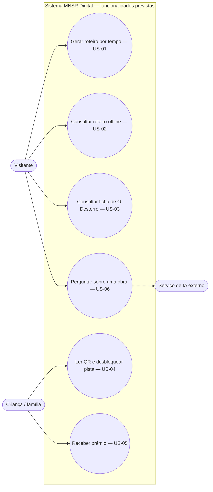
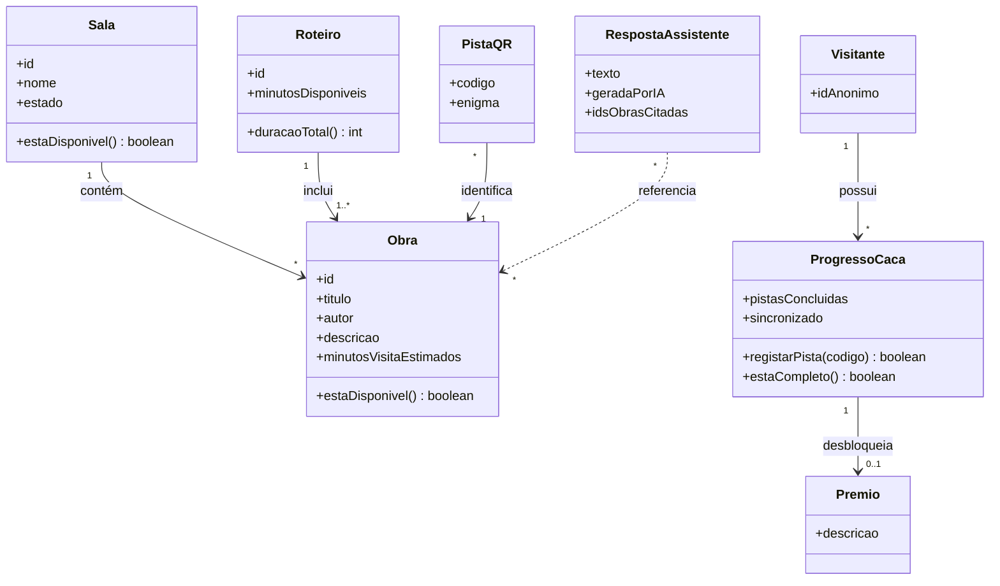
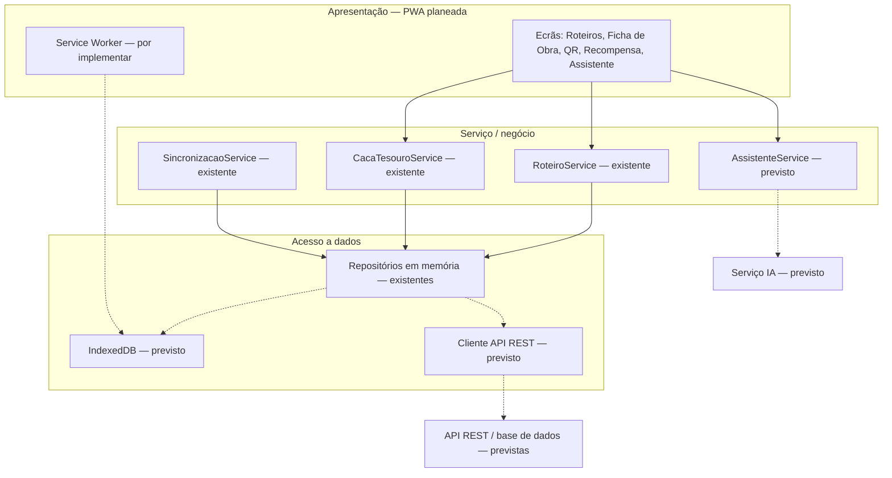
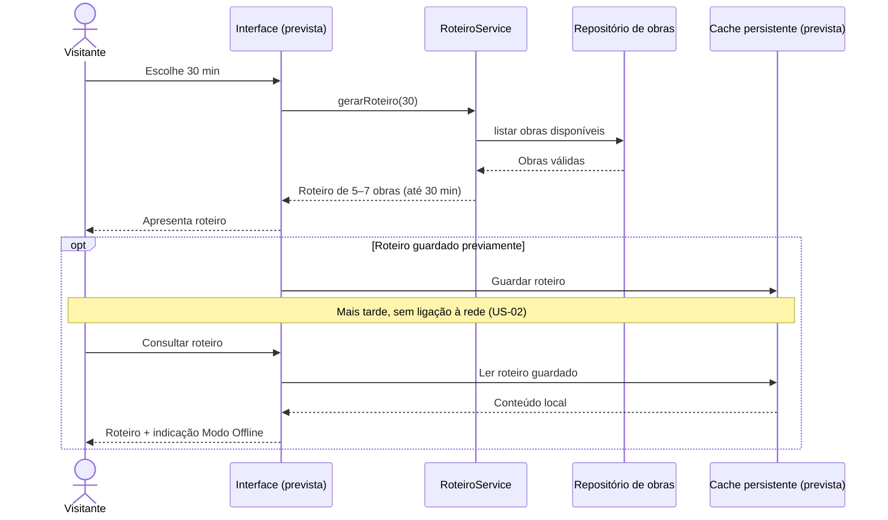
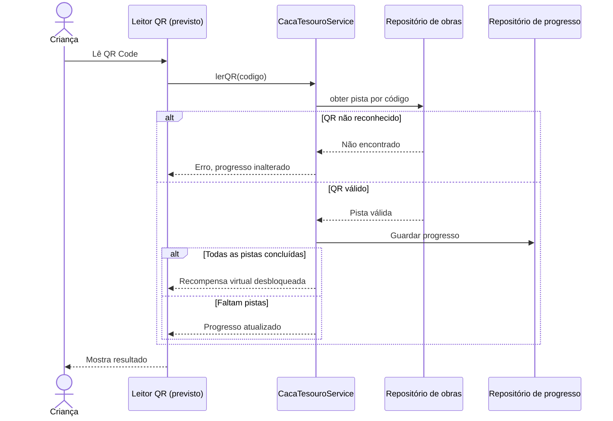
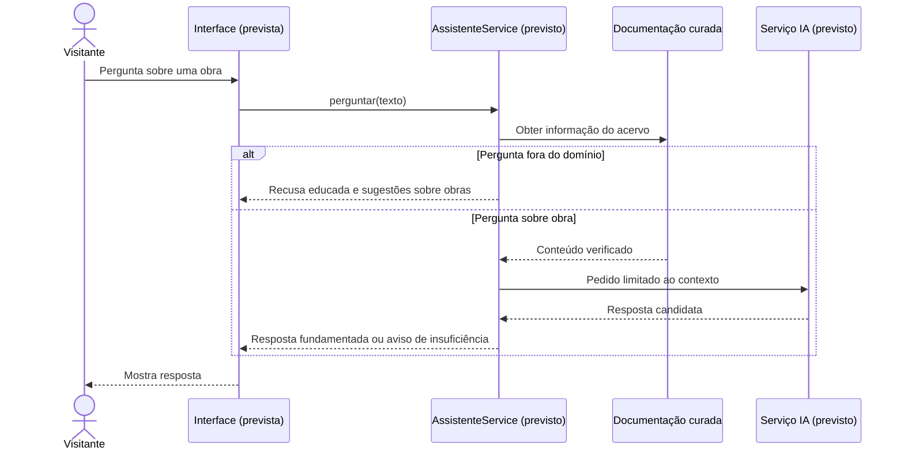

# Arquitetura e modelação UML — App MNSR Digital (M2)

Documento atualizado para usar os identificadores das [issues originais](https://github.com/PedroRodriguesUFP/Projeto-de-ESOF/issues): **US-01** roteiro, **US-02** roteiro offline, **US-03** ficha da obra, **US-04** leitura QR, **US-05** recompensa e **US-06** assistente IA. A arquitetura PWA/REST/IndexedDB é **proposta**; o repositório contém sobretudo lógica de domínio, serviços e repositórios em memória. Ver [requisitos](requisitos.md), [rastreabilidade](rastreabilidade.md) e [decisões ADR](adr/).

## 1. Modelo de casos de uso

O Mermaid não tem um diagrama UML de casos de uso nativo; este fluxograma representa atores e funcionalidades, sem pretender substituir integralmente a notação UML.



O gestor/curador do museu é um stakeholder importante para conteúdos e disponibilidade das obras, mas a gestão de salas e estatísticas de afluência são **ideias futuras**, não a `US-06` do backlog.

## 2. Diagrama de classes — modelo de domínio (visão conceptual)

Inclui entidades previstas no desenho; nem todas correspondem a classes já implementadas.



A ficha completa de **US-03** depende de dados curados (autor, ano, material, texto, áudio e fotografias), alguns ainda não representados no modelo de exemplo. O assistente de **US-06** é ainda uma proposta.

## 3. Arquitetura em camadas



A separação de camadas e as escolhas previstas são justificadas nos ADRs. A execução atual permite `npm run demo`, sem interface gráfica. A presença de um esquema no diagrama **não comprova a implementação** dos seus componentes.

### Serviços e repositórios (estado resumido)

| Componente | Estado em `master` | Papel |
| --- | --- | --- |
| `RoteiroService` | Implementado | Lógica de seleção por tempo e exclusão de obras indisponíveis (US-01) |
| `CacaTesouroService` e `ProgressoCaca` | Implementados | Regras de pistas e prémio (US-04/US-05) |
| `SincronizacaoService` | Implementado | Lógica de sincronização, testada em memória (apoio a US-02) |
| `ObraRepositoryMemoria` / `ProgressoRepositoryMemoria` | Implementados | Dados locais voláteis |
| `AssistenteService` / gateway IA | Planeados | Perguntas fundamentadas no acervo (US-06) |
| `IndexedDB`, `Service Worker` e API REST | Planeados | Persistência offline e serviços remotos |

## 4. Diagramas de sequência — fluxos previstos

### 4.1 Roteiro e consulta offline (US-01 / US-02)



O primeiro fluxo tem lógica no `RoteiroService`; a interface e a cache persistente pertencem ao desenvolvimento futuro.

### 4.2 QR e recompensa (US-04 / US-05)



A validação e o progresso existem na lógica de negócio; a leitura de QR pela câmara e o ecrã de recompensa ainda não existem.

### 4.3 Assistente IA com contexto curado (US-06 — previsto)



Não existe implementação nem teste do assistente IA no núcleo atual. O requisito exige respostas baseadas em documentos do acervo; não se assume que a simples chamada a um LLM garanta essa condição.

## 5. Estrutura existente e componentes futuros

```text
Projeto-de-ESOF/
├── README.md
├── docs/
│   ├── requisitos.md
│   ├── rastreabilidade.md
│   ├── arquitetura.md
│   ├── m3-incremento.md
│   ├── m4-ci-qualidade.md
│   ├── AI_LOG.md
│   └── adr/
├── data/catalogo-exemplo.json
├── src/
│   ├── dominio/       (existente)
│   ├── dados/         (repositórios em memória existentes)
│   ├── servico/       (serviços existentes)
│   └── infra/         (Logger existente)
├── tests/              (testes de unidade e integração)
├── scripts/            (análise estática)
└── .github/workflows/  (CI)
```

**Por desenvolver:** interface PWA, IndexedDB, Service Worker, integração REST e assistente IA. **Por validar:** critérios de aceitação de ponta a ponta, conteúdo real do MNSR e requisitos de desempenho/privacidade da aplicação final.
