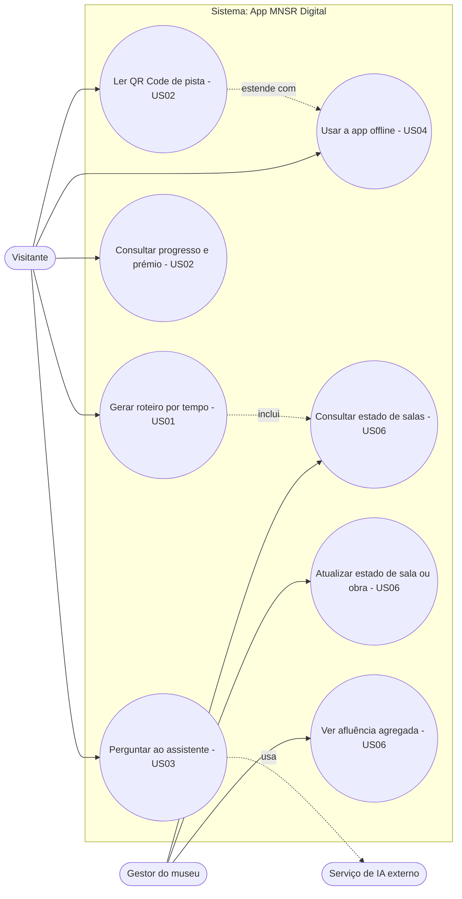
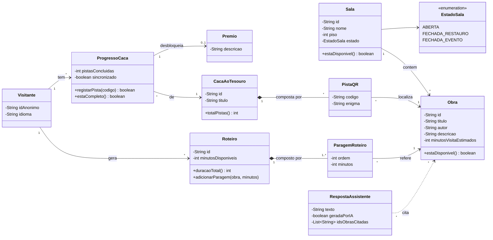
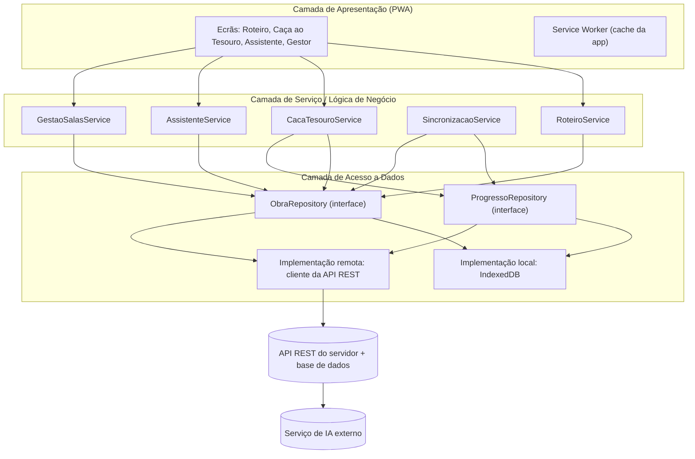
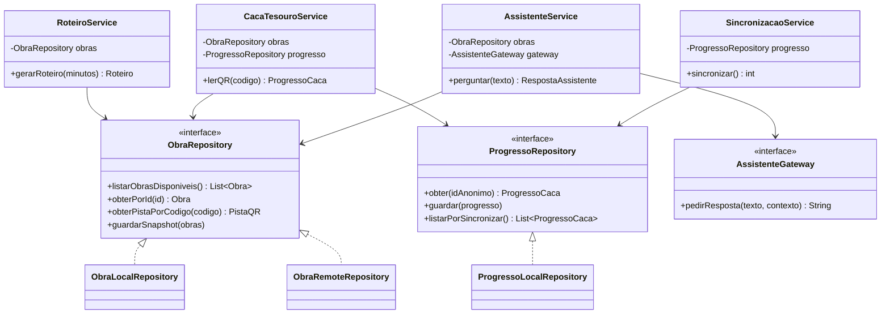
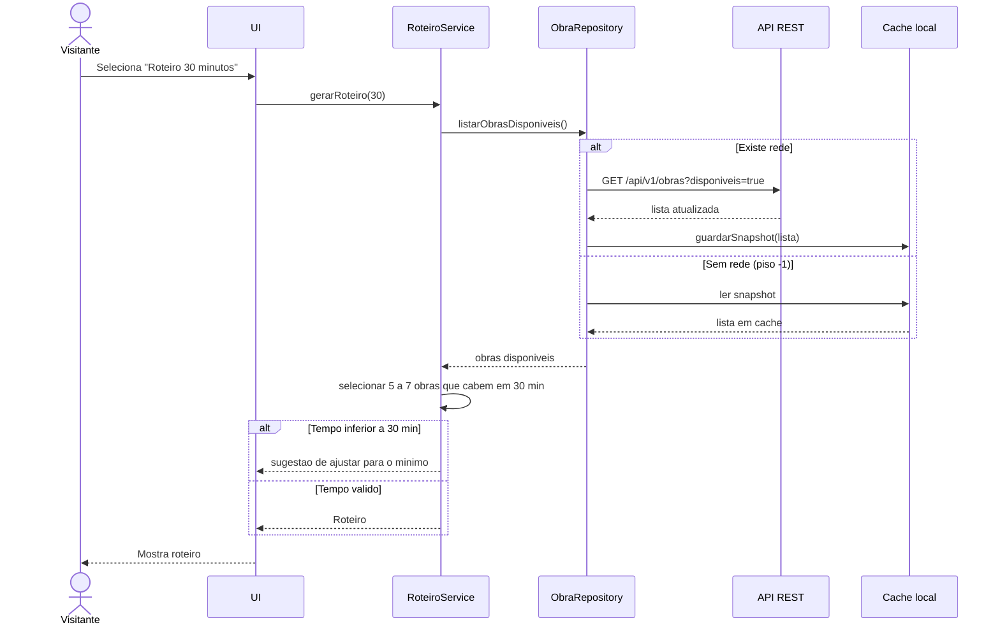
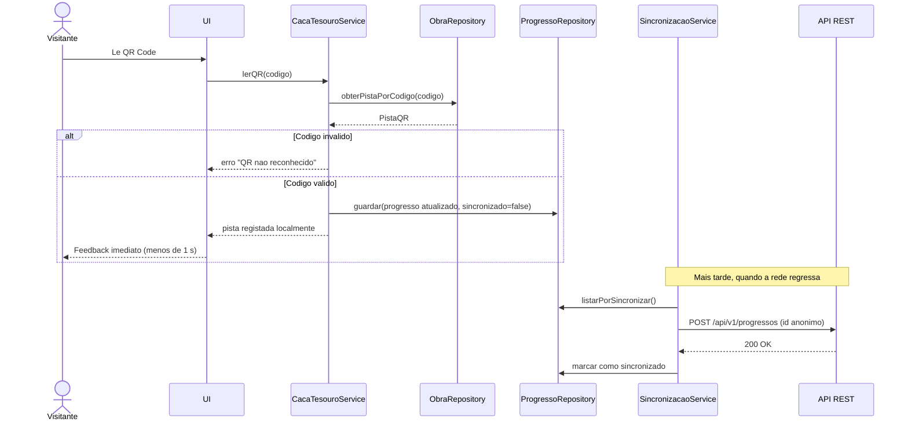
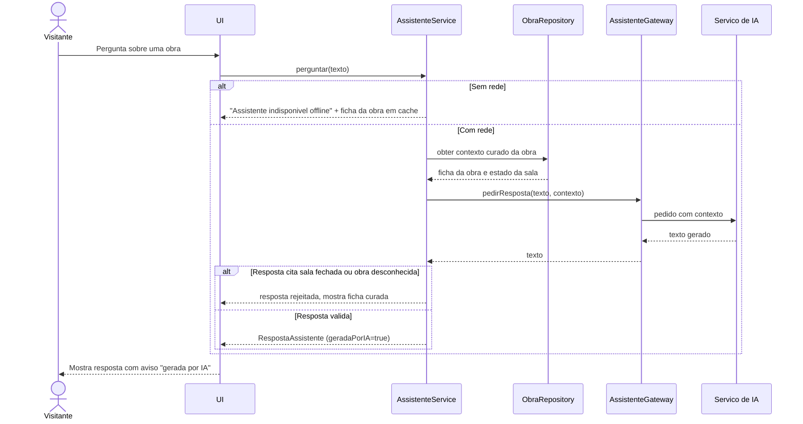

# Arquitetura e modelação UML — App MNSR Digital (M2)

Os diagramas estão em **Mermaid** e renderizam nativamente no GitHub.
Rastreabilidade com requisitos: ver [`rastreabilidade.md`](rastreabilidade.md). Decisões: ver [`adr/`](adr/).

## 1. Modelo de casos de uso

O Mermaid não tem diagrama de casos de uso nativo; usa-se um fluxograma com a mesma semântica (atores à esquerda, casos de uso em elipses).



## 2. Diagrama de classes — modelo de domínio



## 3. Arquitetura em camadas e regra de dependências

Três camadas; as dependências vão **apenas de cima para baixo**, e a camada de serviço depende de **interfaces** (inversão de dependências), o que permite testes unitários com *mocks* (ver ADR-0002).



### Classes de serviço e repositórios (desenho)



## 4. Diagramas de sequência

### 4.1 Gerar roteiro de 30 minutos (US01, US04) — com e sem rede



### 4.2 Ler QR Code offline e sincronizar depois (US02, US04)



### 4.3 Perguntar ao assistente de IA com validação (US03)



## 5. Estrutura de diretórios proposta

```text
Projeto-de-ESOF/
├── README.md
├── docs/
│   ├── AI_LOG.md
│   ├── EQUIPA.md
│   ├── requisitos.md
│   ├── arquitetura.md
│   ├── rastreabilidade.md
│   └── adr/
│       ├── 0001-pwa-offline-first.md
│       └── 0002-arquitetura-em-camadas-e-api-rest.md
├── src/
│   ├── apresentacao/   (UI + service worker)
│   ├── servico/        (RoteiroService, CacaTesouroService, ...)
│   ├── dados/          (repositórios locais e remotos)
│   └── dominio/        (Obra, Sala, Roteiro, ...)
├── tests/              (unitários, integração, sistema)
└── .env.example
```
